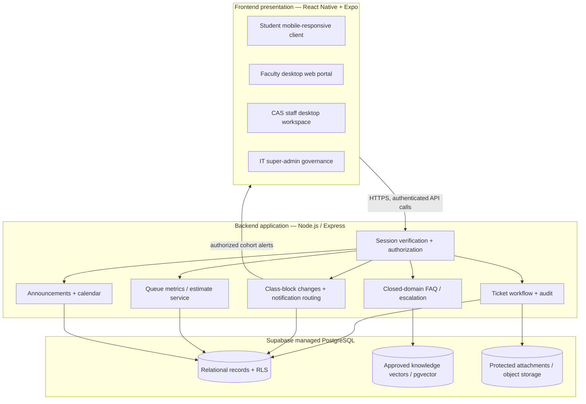
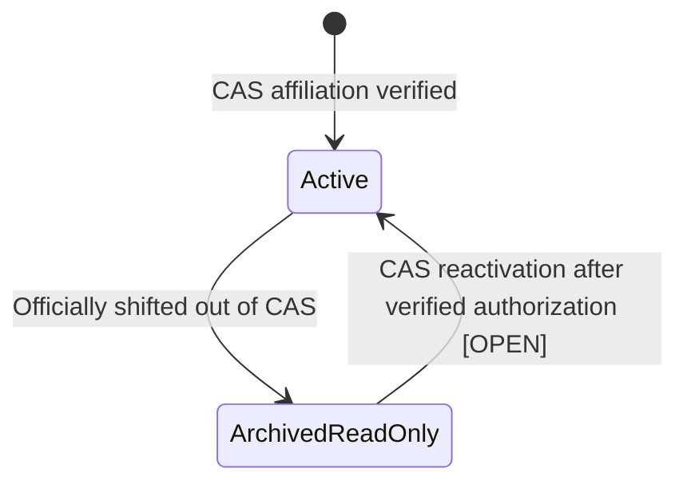

# CAS ASSIST — Solution Architecture

> **Document type:** Target architecture, **not** a claim that the existing repository already implements these components. The backend and permissions come from the paper; visual frontend composition is informed by the provided Base44 screenshots. See `DESIGN.md`.
> **Evidence:** Ch. 3, pp. 60–85 and 98 of `CAPSTONE 1 PAPER.pdf`; requirements and limits from Ch. 1, pp. 14–20.
> **Legend:** **[PAPER]** explicitly specified; **[RECOMMENDED]** proposed implementation detail; **[OPEN]** requires verification/approval.

## 1. Architecture objective

Deliver a single CAS departmental service that reduces in-person advising queues, absorbs routine FAQ traffic, and broadcasts accurate room changes to the students they affect. Maintain consistent security across mobile student experiences and desktop faculty/staff experiences without writing to the official NEU SIS/LMS. **[PAPER]**

## 2. Target three-tier topology



- **Presentation tier [PAPER]:** Expo/React Native shared frontend; desktop-oriented staff/faculty UI, mobile-responsive student UI; browser accessibility is explicitly described in Ch. 3, pp. 62, 77, 83.
- **Business tier [PAPER]:** Node.js/Express API handles RBAC, advising, AI retrieval, faculty room updates and queue calculations.
- **Persistence tier [PAPER]:** Supabase-managed PostgreSQL. Ch. 3 also names Supabase Auth, pgvector, cloud storage and row-level security; use only the actual integrations present/approved for deployment.
- **Realtime/notification transport [RECOMMENDED choice]:** For connected clients, subscribed event streams or Supabase realtime; for background/device alerts, a supported web-push or Expo notification mechanism. The paper desires targeted instant *web push*, but the exact notification implementation is not settled.
- **Deployment [OPEN]:** Documented delivery is desktop browser + mobile browser; Expo also permits native builds, which are **not** automatically in scope.

### Request boundary rule

Do **not** trust UI visibility or a client-supplied `role`, `student_id`, `faculty_id`, or `class_block_code` as authorization. Validate identity, active CAS affiliation, and resource ownership **on the server and database policy layer**. **[RECOMMENDED enforcement of PAPER RBAC]**

## 3. Bounded modules (paper's 22 modules grouped)

| Domain | Paper modules | Key boundaries |
|---|---|---|
| Identity + governance | 1 registration; 2 RBAC; 3 account lifecycle; 4 student profile/history | Verified CAS identity; student archival; authorized self-read |
| Advising | 5 request form; 6 file upload; 7 staff grid; 8 student status; 9 audit log | Student-owned submissions; clerk-controlled workflow; protected evidence |
| Closed-domain AI | 10 question capture; 11 vector mapping; 12 answer feedback; 13 ticket escalation | Approved sources only; non-authoritative AI; human handoff |
| Faculty spatial updates | 14 faculty block editor; 15 cohort isolation; 16 targeted broadcast | Only assigned blocks; correct recipient set; current schedule |
| Department content | 17 announcements CMS; 18 official feed; 19 calendar | Controlled publishing, chronology, expiry |
| Queue analytics | 20 Little's Law; 21 triangular duration; 22 reporting | Observable data, transparent estimates, aggregate staff metrics |

**Reference:** Ch. 3, pp. 66–72.

## 4. Role authorization (must be enforced in API and RLS)

Based on Table 3.1, p. 65:

| Operation | Student | Faculty | Office staff | Super admin |
|---|---|---|---|---|
| Announcements/calendar | Read | Read | Create/edit/delete | Full control |
| AI FAQ | Query (active CAS only) | No | No | Knowledge-base administration |
| Advising tickets | Create/read own | No | Update/route/resolve | Audit |
| Spatial classroom logs | Read applicable | Create/update own blocks | Read | Database/admin maintenance |
| Accounts/system configuration | No | No | No | Full control |

**Important nuance:** Do not interpret super-admin's configuration rights as permission to impersonate professors, change grades, or grant AI academic decision authority. Apply least-privilege controls to any administrative intervention. **[RECOMMENDED]**

### Student lifecycle



**[PAPER]:** Active can submit/track and query AI; archived can see authorized historical ticket and clearance information, but cannot create tickets or query AI. Restoration is **not described** in the paper and requires policy approval before automation.

## 5. Data structures: paper-defined versus necessary supporting records

### 5.1 Explicitly documented in Ch. 3 data dictionary

| Table/entity in paper | Documented columns | Purpose | Source |
|---|---|---|---|
| `users_account_registry` | `user_id` UUID PK, `email_domain` varchar, `rbac_role_tier` enum, `lifecycle_state` enum, `created_at` timestamp | Verified account identity and role/state | pp. 79 |
| `advising_ticket_pipeline` | `ticket_id` bigint PK, `student_id` UUID FK, `request_category`, `lifecycle_status`, `justification_text`, `attachment_url`, `created_timestamp` | Student advising lifecycle and queue input | pp. 80–81 |
| Spatial logs synchronizer (table name not formally standardized) | `log_id` UUID PK, `class_block_code`, `faculty_id` UUID FK, `allocated_room_string`, `broadcast_timestamp` | History of faculty room relocation events | pp. 81–82 |

The above reproduces the **paper's specified fields**, not a verified physical schema. The paper does not supply a full ERD/database migration specification for all 22 modules.

### 5.2 Recommended supporting data entities — design proposals

These tables/collections are **not asserted to exist in the research paper**. They are suggested because the documented features require persistent, secured relationships:

| Entity proposal | Essential fields / purpose |
|---|---|
| `cas_affiliations` | user, verified program code, verification source, active/archive dates; protects CAS-only access without direct SIS writes |
| `course_blocks`, `block_enrollments`, `faculty_assignments` | subject, section, block, student membership, faculty ownership; indispensable for safe cohort targeting |
| `advising_ticket_events` | ticket ID, actor, before/after state, action, timestamp, immutable event metadata |
| `advising_staff_notes` and `ticket_messages` | internal staff-only notes versus separately authorized student-visible questions/answers |
| `ticket_attachments` | ticket ID, storage object key, content type/size, upload actor, access scope |
| `knowledge_documents`, `knowledge_chunks`, `knowledge_versions` | approved source identity, effective date, revocation/publish status, vector reference |
| `ai_query_sessions`, `ai_resolution_feedback` | query session, answer/reference, resolved feedback, escalated ticket reference; minimize personal-data storage |
| `announcements`, `calendar_events` | publisher, audience, effective/expiry time, priority; controlled content lifecycle |
| `room_change_events`, `notification_deliveries`, `notification_inbox` | event, target membership snapshot, delivery attempts, read state, audited recipient routing |
| `ticket_queue_metrics` | cohort/time window, sampled arrival and resolution observations, estimate basis, last-updated time |

Use existing schema equivalents if present; avoid creating duplicate tables just to match these example names. **[RECOMMENDED]**

### Data-classification guidance [RECOMMENDED]

- Restricted: academic justifications, grades/checklist attachments, per-student tickets, auth/session material, internal evaluations.
- Internal: routing notes, full audit events, staff operational logs, knowledge approval controls.
- Department-published: official announcements, calendar items, verified FAQ documents approved for student access.
- Aggregated: queue and usage metrics without unnecessary student identifiers.

## 6. Core event sequences

### A. Student advising request

1. Student authenticates, API confirms active CAS status and `student` permission.
2. Validate category and justification; validate attachment constraints and route to protected storage.
3. Create ticket transactionally with `Submitted`, server timestamp, student ownership and audit event.
4. Return ticket ID, student-facing timeline and applicable approximate wait details.
5. Staff routes to an authorized desk; transitions state to `Under Evaluation`, `Action Required`, or `Resolved` with reason, timestamp and audit event.
6. Notify student without exposing staff-only notes; display the exact current state.

**[PAPER]** steps from Ch. 3, pp. 68–69, 76, 84–85; explicit idempotency/transaction design is **[RECOMMENDED]**.

### B. Closed-domain information deflection

1. Student submits a normal-language question.
2. API verifies student active-CAS privilege.
3. Retrieve relevant *approved, effective* CAS handbook/procedure/memo passages using pgvector or equivalent.
4. If no sufficiently supported answer, **abstain** and offer a human-handled ticket; do not invent policy.
5. Present answer and resolution feedback. If not helpful, offer to prefill a ticket with **user-reviewed** question/context.
6. Track aggregate deflection counts without retaining excessive sensitive chat content.

**[PAPER]** flow on pp. 69–70, 84; source citation, abstention details and user review are **[RECOMMENDED]** safety controls.

### C. Faculty room relocation

1. Faculty selects a block from *their* verified assignments.
2. Server validates the classroom choice, permission and current block membership.
3. Write room-change history and update the live location atomically or with a consistent event/outbox approach.
4. Resolve recipients from current enrollment; publish targeted event **only** to that set.
5. Affected student schedules reflect the new room and last-updated timestamp; missed delivery can be recovered in an inbox. *(Inbox: RECOMMENDED.)*

**[PAPER]** flow: Ch. 3, pp. 70–71, 85.

### D. Official publishing / analytics

- Authorized staff publish notices and calendar entries with visible status, date, target audience and expiry. A student sees only current relevant official notices.
- Aggregate ticket creation, status and processing intervals are transformed into time-bounded queue diagnostics. Distinguish operational metrics from policy decisions.

## 7. Queue estimation: research formula and its limits

The paper describes two methods (Ch. 3, pp. 71–72, 85–87):

1. **Little's Law:** `W = L / λ`, with `L` as average number of requests in the system and `λ` as throughput/arrival rate under suitable stable conditions. Units must match (e.g. tickets ÷ tickets/hour = hours).
2. **Triangular expected service duration:** `E = (a + b + c) / 3`, with `a` minimum, `b` maximum, `c` most likely. The paper proposes an estimate based on expected duration and queue position.

**Technical validation warning [RECOMMENDED]:** Little's Law is a long-run relation under appropriate assumptions, **not an automatically precise personal countdown**. The paper informally mixes a queue-length snapshot and an arrival rate and also proposes `E × queue position`. Actual waiting depends on parallel service capacity, in-progress tickets, priority policies, and historical sample quality. Therefore:

- Label results **estimated**, never guaranteed.
- Define whether `L` means waiting queue only or all tickets in the system, and use a consistent corresponding rate.
- Prefer observed service throughput and historical processing measurements for calibration; account for simultaneous clerks/servers.
- Show `Unavailable — insufficient recent data` rather than divide by zero or make up a duration.
- Record calculation basis, timestamp, and validation error against actual completion history before calling the estimate accurate.
- Don't silently change the research's requested methods; document an improved estimator as a separately approved engineering refinement.

## 8. Trust and security boundaries

**[PAPER constraints]** Institutional `@neu.edu.ph` identity; active CAS only; four roles; RLS and server-side RBAC; secure transport (Ch. 3 specifies HTTPS/TLS 1.3); no official SIS/LMS writes; no AI approval/waiver; no financial/grade transactions.

**[RECOMMENDED controls]**

- Verify identity server-side using token verification; authorize every resource query, not just screen access.
- Apply RLS to every restricted table, including storage-object or signed-file access; default deny.
- Validate all filenames, MIME types, actual contents, file sizes, allowed extension categories and attachment ownership.
- Keep privileged Supabase service-role secrets and AI provider keys off the client; Expo public environment values are **not secret storage**.
- Audit role/lifecycle changes, publishing actions, ticket transitions, room changes and knowledge-document approvals.
- Use time-bounded signed attachment URLs, least-privilege worker credentials, safe input validation, rate limiting and idempotency where appropriate.
- Ensure notification payloads do not disclose sensitive student details on device lock screens.
- Track approval and revision history of AI knowledge sources, and mark stale content as unavailable until updated.

## 9. Validation and architecture test seams

| Boundary | Negative/positive test needed |
|---|---|
| Identity | Non-NEU account denied; `@neu.edu.ph` account with no CAS verification does not gain CAS access. |
| RBAC/RLS | Student A cannot fetch Student B's ticket/file; Faculty A cannot change Faculty B's block. |
| Archival | Shifted-out student can read authorized history; ticket creation/AI endpoint rejected. |
| Ticket | Duplicate retries do not create duplicates; failed attachment upload produces recoverable state. |
| AI | Unapproved/inapplicable policy fails closed; unresolved question can become a ticket. |
| Cohort notifications | Only students in selected class block receive room update; roster mismatch is surfaced. |
| Queue | Empty/zero-rate/insufficient history handled gracefully; estimates are not framed as guarantees. |
| Admin | Auditing and restricted notes cannot be edited by students, faculty or ordinary staff without authorization. |

## 10. Known architectural decisions still open

1. Paper says **Expo React Native** and **mobile-responsive web**; actual client build targets/entry points must be checked in the repository.
2. Automatic CAS shift detection and cohort isolation need a trusted enrollment/program source, yet **direct SIS/LMS integration is excluded** (Ch. 1, pp. 18–19). Use an approved CAS-controlled source or periodic verified data transfer; do not assume live SIS access.
3. Paper mentions push/real-time web alerts; choose specific delivery transport after confirming hosting, browsers, notifications permission, and offline cases.
4. Paper lists **three main tables** but does not fully define schema for all 22 modules. Design supporting relationships explicitly and validate existing migrations first.
5. The paper does not define staffing queues, queue priority discipline, retention periods, file allowlists, or detailed reopening rules. Obtain CAS approval before encoding them as policy.

**Source references:** Ch. 1 pp. 14–20; Ch. 3 pp. 60–85, 86–87 (formulas), 92, 96–98. Figure 3.1 (p. 61) is the three-tier environment; Figure 3.3 (p. 75) shows external data flows; Figure 3.5 (p. 78) shows cloud networking.


## 11. Base44-inspired presentation architecture (visual only)

**Evidence:** Screenshot bundle `CAS-ASSIST2.0 BASE44 IMGS.zip`, preserved in `design-reference/base44/`. This section guides frontend implementation, not backend scope. The reference images overwhelmingly show *desktop web* views; they are **not** an existing React Native component tree or a mobile design specification.

```text
Expo / React Native for Web presentation layer [PAPER technology]
├── Shared presentation [BASE44 visual cues + RECOMMENDED code layout]
│   ├── Theme/tokens (navy, teal, pale mint, white, subtle borders)
│   ├── Typography (serif-like large editorial headings; compact sans UI)
│   ├── UI primitives (Button, Card, Badge, Field, EmptyState, StatusPill)
│   ├── Responsive AppShell (desktop icon rail + group nav / mobile route navigation)
│   └── Data components (MetricCard, FilterBar, DataTable, Timeline, ActivityFeed)
├── Student mobile-friendly features [PAPER workflows; mobile adaptation]
│   ├── CAS sign-in/verification, home, profile
│   ├── My advising requests + submit request + attachments + status timeline
│   ├── Closed-domain AI + FAQ + human escalation
│   ├── Announcements/calendar and own schedule + class changes
│   └── Estimated queue wait and in-app notification visibility
├── Faculty desktop features [PAPER]
│   ├── Assigned class blocks and teaching schedule
│   └── Room-change publisher and change history
├── Staff desktop features [PAPER]
│   ├── Advising ticket table/detail and authorized triage
│   ├── Announcement publisher and calendar entries
│   └── Queue operational views as permitted
└── Super-admin desktop features [PAPER]
    ├── CAS account verification / access governance
    ├── Approved knowledge-base maintenance
    └── Audit review and system configuration
```

**Do not interpret this tree as an instruction to reorganize a repository that has not been inspected.** Reuse existing navigation, design-system, screen and service conventions where maintainable; add only needed components.

### Component-to-source map

| Presentation surface | Image reference(s) | Paper function retained |
|---|---|---|
| Auth screens | `Login.png`, `Register.png`, `ForgotPassowrd.png`, `ResetPassword.png` | Verified institutional access, no automatic role promotion |
| Web application shell | `Super_Admin Dashboard.png`, `Profile.png`, `Requests.png` | Role-specific navigation with guarded modules |
| Ticket table and queue | `Requests.png`, `Queue.png` | Advising submissions, sorting and staff processing |
| Ticket detail/timeline | **No usable direct screenshot** (`RequestTicketID.png` is placeholder) | Exact four-state workflow from Chapter 3 |
| AI and FAQ | `AI-Assistant.png`, `FAQs.png` | Closed CAS content plus explicit escalation |
| Class management | `Teaching.png`, `Academics.png`, `Classroom Changes.png` | Scoped faculty room-change workflow and targeting |
| Information and alerts | `Announcements.png`, `Notifications.png` | Official notice publishing and relevant in-app alert view |
| Metrics and governance | `Analytics.png`, `User Management.png`, `Service Configuration.png` | Role-scoped aggregates and IT system governance |
| Audit details | **No usable direct screenshot** (`Audit Logs.png` duplicates AI image) | Immutable protected-action trail, designed afresh |

### Separation of concerns [RECOMMENDED]

- **UI does not grant rights.** Hide unauthorized controls in UI, but rely on server-side checks and relevant database policies for enforcement.
- **Theme is a shared dependency, not a business service.** Store tokens separately from feature-specific rules; do not embed theme choices in API responses or DB data.
- **Desktop table ≠ mobile table.** Allow the same ticket/query data to render as desktop rows or mobile cards with consistent status behavior.
- **Keep document requests separate from attachments.** Image `Documents.png` shows a broad service not fully specified in paper; the core architecture supports protected file attachments to advising tickets.
- **Keep appointment booking separate from queue forecasts.** Image `Appointments.png` is visual inspiration only; the study's queue research focuses on ticket arrival/processing data and mathematical waiting estimates.
- **API/Data-layer objects are not inferable from screenshots.** The screenshots do not verify routes, tables, OAuth, permission models, or supported transactions.

### Verified Phase 1 implementation observations — 2026-11-09

The local implementation uses direct authenticated Supabase queries/RPCs for most screens and an optional Express gateway for queue, AI, and notifications. This differs from the exclusively API-mediated target diagram above. Phase 1 preserves that architecture and hardens both boundaries; it does not migrate existing screens to REST.

- `Backend/src/middleware/auth.ts` verifies the bearer identity and registry profile. `requireVerifiedCas` requires an active, verified account; students also require a managed current membership in an active CAS program, within its start/end dates. A verified faculty/staff/super-admin registry role is the existing administrator attestation; no separate institutional personnel roster is available in the schema.
- `Backend/supabase/migrations/202611090001_phase1_security_hardening.sql` adds matching access helpers and restrictive RLS gates. Pending accounts retain their own onboarding reads. Verified archived accounts retain existing row-scoped historical reads without requiring current enrollment; operational mutations require active verified CAS access.
- Queue estimate and queue analytics RPCs become service-role-only. Express checks the original end user and derives the student identifier from the verified session; service-role calls do not rely on the original user's `auth.uid()`.
- The frontend's two ticket-status writers use `transition_advising_ticket_status(uuid,text)`. This controlled authenticated RPC changes workflow fields only and retains the existing transition and audit triggers. Direct authenticated ticket table/column UPDATE privileges are revoked.
- Frontend operational entry is gated by `has_active_cas_access()`, with a verification-status view for restricted accounts. Supabase authentication itself remains available.

These observations describe local code and a prepared migration, not an applied production schema. Database execution and deployed behavior remain unverified. See `docs/reviewer/PHASE1_SECURITY_IMPLEMENTATION_REPORT.md` and `PHASE1_SECURITY_TEST_RESULTS.md` for evidence and limitations.

### Assets and source paths

The archive includes `design-reference/base44/*.png`. In the user's development environment, the source material was described as `D:\Dave Files\Capstone 2\CAS-ASSIST2-REFERENCE`; that path was **not directly inspected**. Actual provided images came from `CAS-ASSIST2.0 BASE44 IMGS.zip`. Use the bundled relative assets to ensure Codex and teammates can reproduce the visual analysis. Do not embed absolute `D:` paths into runtime app code.

### Verified Step 2 local administrative foundation — 2026-11-13

The four application roles and all existing operational route/permission checks remain unchanged. New account-administration authorization is additive and not mounted on current routes:

- `Backend/supabase/migrations/202611130001_admin_authority_foundation.sql` prepares unexposed `cas_admin.authorities`, keyed to registry/Auth UUIDs with deletion restriction, `primary`/`delegated` levels, a unique primary index, explicit ACL revocation (including direct service-role access), and RLS without client policies. No user or authority designation is inserted.
- Service-only `public.get_admin_authority_context(uuid,uuid)` reads the current eligible primary/actor and optional target in one stable database snapshot. It validates active verified super-admin status and matching institutional Auth/registry identities. It does not authorize an arbitrary client actor or perform a mutation. The backend must derive actor UUID from a freshly validated bearer identity.
- `Backend/src/middleware/admin-authority.ts` validates that context and explicitly authorizes primary-only creation, invitations, final CAS approval, identity/role changes and reactivation. Delegates may only receive ordinary permitted-target decisions; primary/self and privilege-escalation paths are denied. Authority-holder role changes/deletion require controlled deprovisioning. There is no generic/bulk account endpoint.
- The RPC's context is not an atomic grant for a future Auth mutation. New handlers must check the actual action/target again immediately before privileged work, validate fields/recovery destinations, translate `AdminAuthorizationError`, and record the original actor. No caching or frontend authority storage is introduced.

This is locally implemented source plus an **unapplied** additive migration and prepared isolated SQL tests. Existing signup/CAS verification UI and all dashboards remain intact. Provisioning, final-approval writes, recovery, initial bootstrap execution and provider signup closure are later steps. See `docs/reviewer/STEP2_ADMIN_AUTHORITY_IMPLEMENTATION.md`, `STEP2_ADMIN_AUTHORITY_TEST_RESULTS.md`, and `STEP2_ADMIN_AUTHORITY_REMAINING_RISKS.md` for validation and bootstrap boundaries.
