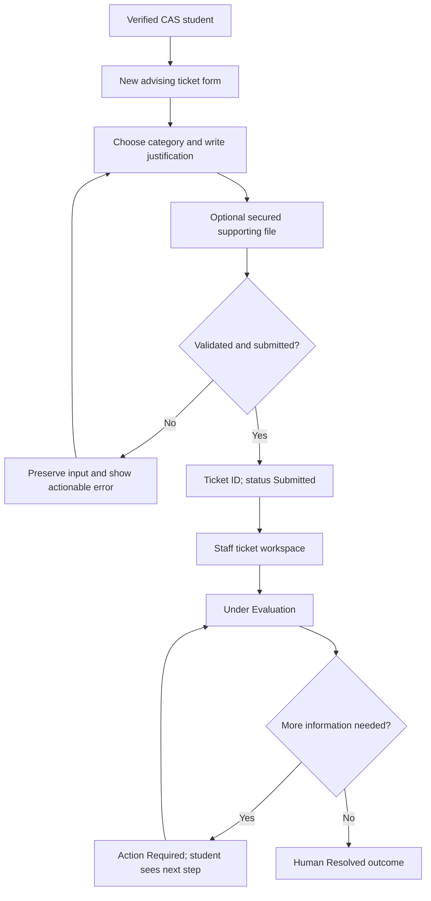
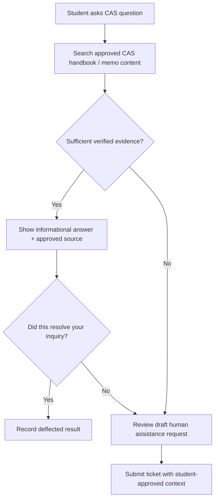
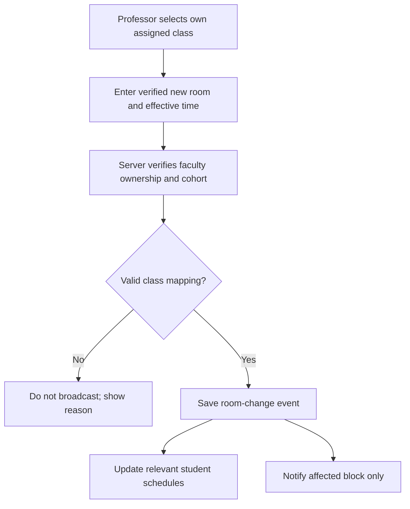

# CAS ASSIST — UI/UX Design Specification (Base44-Aligned)

> **Goal:** Implement the features required by **Chapters 1–3** of `CAPSTONE 1 PAPER.pdf` with the **appearance and interaction language** of the user-supplied Base44 screenshot bundle `CAS-ASSIST2.0 BASE44 IMGS.zip`.
>
> **Design-source directory:** `design-reference/base44/` (24 original screenshots included with this documentation package). The folder previously named by the user on Windows, `D:\Dave Files\Capstone 2\CAS-ASSIST2-REFERENCE`, was not directly accessed; the uploaded ZIP is the image source actually reviewed.
>
> **Authority:** `[PAPER]` = mandatory paper scope/workflow; `[BASE44]` = visible screenshot pattern; `[ADAPTATION]` = recommended UI specification extending that visual pattern to paper-required screens or to mobile; `[OPEN]` = not specified by the research/screenshots, needs approval. Screenshot-only services do not become mandatory product features.
>
> **Important:** These are **design specifications**, not a report that the Expo repository already implements the screens. The screenshots appear to be desktop web preview captures; none shows a full narrow mobile student screen. User-facing copy and visual tokens below are recommendations, not official NEU brand standards.

## 1. Design brief: problem first, visual second

| Real CAS problem `[PAPER]` | What the interface must make easy | Relevant screenshot styling |
|---|---|---|
| Irregular/backlog students must line up in person and cannot track requests. Ch. 1 pp. 15–16 | Submit an advising concern from a phone, attach supporting documents, receive ticket ID, see four-state progress, and know the next action | `Requests.png`, `Queue.png`, `Profile.png` for card/table/status language; student form/timeline **adapted** |
| Tier-1 questions consume office time. Ch. 1 pp. 15–16 | Ask the CAS AI, see a grounded answer, mark helpfulness, and escalate to a human if unresolved | `AI-Assistant.png`, `FAQs.png` |
| Room relocations miss the affected class block. Ch. 1 pp. 15–16 | Faculty publish one verified block-specific room change; only enrolled students see it prominently | `Teaching.png`, `Academics.png`, `Classroom Changes.png`, `Notifications.png` |
| Fragmented and unofficial announcements. Ch. 1 pp. 13–15 | Official CAS updates and academic deadlines are easy to locate and distinguished from general content | `Announcements.png`, `Notifications.png`, `Home.png` |
| No visibility into queue performance. Ch. 1 pp. 16–17 | Staff see current advising workload, students see an honest estimated wait, administration sees trends | `Queue.png`, `Analytics.png`, `Super_Admin Dashboard.png` |

**Design success:** A verified student can answer "Where is my class? What's the status of my advising request? What is the official CAS instruction?" from mobile; staff can find and process requests from desktop; faculty can issue a scoped room change without accidentally notifying unrelated students.

## 2. What the Base44 images actually show

The screenshots share a recognizable interface system:

- **Overall feel:** clean institutional SaaS workspace, light gray-white surfaces, cool mint/teal accents, dark blue-green typography and primary actions. `[BASE44]`
- **Desktop structure:** a very slim dark/icon rail at far left, a secondary pale sidebar with grouped routes, a modest header bar with utility controls, and a roomy content region. `[BASE44]`
- **Page titles:** larger editorial/serif-like titles above smaller muted descriptions. Labels, tabs and tables use compact sans-serif type. `[BASE44]`
- **Cards:** predominantly white with rounded corners, subtle shadows/low-contrast borders, small muted uppercase eyebrow labels, and restrained teal status indicators. `[BASE44]`
- **Controls:** navy filled primary pill/rounded buttons; quiet outlined secondary buttons; form inputs and filters with thin light borders; soft mint active menu background. `[BASE44]`
- **Data presentation:** KPI tiles, structured tables, searchable filter bars, announcements as stacked cards, empty states centered inside content regions, analytics as chart cards. `[BASE44]`
- **Not product UI:** blue viewport-resolution text, dark black dotted strip above the screenshots, browser/preview framing and blue screenshot borders must **not** be reproduced in the application. `[BASE44 capture artifacts]`

### Complete visual inventory — all 24 assets

| File | Actually visible | Product disposition |
|---|---|---|
| [`Home.png`](design-reference/base44/Home.png) | Public landing/role-selection content with CAS ASSIST 2.0 hero and large choice cards | **Style reference only** for an optional entry page; not a student home mockup |
| [`Login.png`](design-reference/base44/Login.png) | Centered login card with Google option and email/password fields | **Adapt** to verified `@neu.edu.ph` identity; Google login method not required by paper |
| [`Register.png`](design-reference/base44/Register.png) | Centered student registration card and password confirmation | **Adapt**; signup does not itself approve CAS/role eligibility |
| [`ForgotPassowrd.png`](design-reference/base44/ForgotPassowrd.png) | Single-purpose request-reset card | **Adapt** if password auth is supported (original filename spelling preserved) |
| [`ResetPassword.png`](design-reference/base44/ResetPassword.png) | Invalid reset-link error state | Use layout/state pattern, **not** evidence of successful reset screen |
| [`Super_Admin Dashboard.png`](design-reference/base44/Super_Admin%20Dashboard.png) | Admin hero card, KPI tiles, three-panel metrics, audit/notice summaries | **Adapt** to authorized CAS overview data and functions |
| [`Requests.png`](design-reference/base44/Requests.png) | Ticket-management page with search and many filters; empty-result state | Staff advising grid inspiration; actual backend/states must match the research |
| [`RequestsNew.png`](design-reference/base44/RequestsNew.png) | Nearly same ticket listing view rather than a fully visible creation form | **Do not claim** it specifies the new-request form |
| [`RequestTicketID.png`](design-reference/base44/RequestTicketID.png) | Dynamic-page loading/preview placeholder | **No usable ticket-detail UI**; design ticket detail from paper |
| [`Queue.png`](design-reference/base44/Queue.png) | Queue-management KPIs, service-day/status/counter filters, counter cards and empty state | Adapt ticket/queue metrics; counter numbering/config is not automatically a required paper feature |
| [`Documents.png`](design-reference/base44/Documents.png) | General document-processing list/filter page | Reuse layout for **advising attachments**; don't add registrar issuance without approval |
| [`Appointments.png`](design-reference/base44/Appointments.png) | Appointment-management metrics and service-window scheduling panel | **Reference-only/possible future extension**, not a mandatory Chapter 3 module |
| [`Teaching.png`](design-reference/base44/Teaching.png) | Faculty teaching load: assigned sections, schedule and room-change summary | Strong paper-aligned faculty dashboard pattern |
| [`Academics.png`](design-reference/base44/Academics.png) | Academic sections table, faculty assignments and meeting actions | Visual pattern for schedules/assignments; only permitted actors can edit data |
| [`Classroom Changes.png`](design-reference/base44/Classroom%20Changes.png) | KPIs, class selector, room-change form, effective date/time and notice listing | Closest design reference for faculty room changes |
| [`Announcements.png`](design-reference/base44/Announcements.png) | Official notice cards with metadata, priority, new-announcement CTA and filters | Strong paper-aligned communication surface |
| [`Notifications.png`](design-reference/base44/Notifications.png) | Notification activity page, unread filter, mark-all-read, empty state | Supports proposed persistent notification inbox design |
| [`AI-Assistant.png`](design-reference/base44/AI-Assistant.png) | Two-column AI chat: main chat area, suggested questions, service catalog and limits copy | Strong paper-aligned visual model; enforce closed-domain and escalate |
| [`FAQs.png`](design-reference/base44/FAQs.png) | FAQ knowledge-base heading, search/category controls, expanders and new-article button | Supports approved-source content management; writing rights are restricted |
| [`Analytics.png`](design-reference/base44/Analytics.png) | Report filters, KPI cards, bar/donut chart panels, workload summaries | Strong paper-aligned report layout |
| [`User Management.png`](design-reference/base44/User%20Management.png) | Account list, role counts, search/filter, role/state action controls | Strong super-admin access/verification visual pattern |
| [`Service Configuration.png`](design-reference/base44/Service%20Configuration.png) | Department, category, document type, counter settings in card columns | **Use only necessary/approved settings**; screenshot catalogs exceed paper-defined schema |
| [`Audit Logs.png`](design-reference/base44/Audit%20Logs.png) | **Pixel-identical to `AI-Assistant.png`**, not an audit-log view | No reliable audit-log screenshot; derive table design from Requests/User Management |
| [`Profile.png`](design-reference/base44/Profile.png) | Profile form on left and account/access/theme panels on right | Adapt to role and academic information while preserving server-owned identity fields |

**Source conflict policy:** When an image implies a booking, document-issuance, counter, role or permission feature absent from the paper, **retain the visual styling and omit the unsupported business function**. Consult `PRD.md` and `RULES.md` before implementing any visible action.

## 3. Suggested design tokens (approximations, not an official brand palette)

The screenshots are raster images, not exported Figma/Base44 CSS. These values are **practical starting points** inferred from appearance, to validate with actual device/browser previews:

```ts
// Recommended theme sketch; do NOT assume these are authoritative pixel-exact values.
export const casTheme = {
  colors: {
    canvas: '#F3F8F7',       // pale mint-tinted workspace background
    surface: '#FFFFFF',      // white card / sidebar surface
    surfaceAlt: '#EDF5F4',   // quiet panel and hover background
    primary: '#102B36',      // dark blue-green action buttons and headings
    primaryHover: '#1B4050',
    accent: '#109C94',       // subdued teal for active/selected controls
    accentSoft: '#DDF3F0',   // sidebar active state / pills
    text: '#243D45',
    textMuted: '#72848B',
    border: '#E1EBEA',
    danger: '#B54C4C',
    warning: '#9A6A20',
  },
  radii: { control: 8, card: 12, panel: 16, pill: 999 },
  spacing: { xxs: 4, xs: 8, sm: 12, md: 16, lg: 24, xl: 32 },
};
```

- **Typography:** use a restrained serif/display face for major headings *only if a compatible licensed font is already in the repo*; otherwise use a system serif (`Georgia` on web) as an approximate display fallback. Use a readable system sans (`Inter` if already available, otherwise system/Arial) for navigation, data grids, forms, chips, and body text. `[ADAPTATION]`
- **Hierarchy:** small muted upper labels (11–12 px), body 13–15 px on desktop and 14–16 px on mobile, section headings ~20–24 px, key editorial headings ~24–28 px, KPI values ~22–28 px. These are proposed sizes, not measurements. `[ADAPTATION]`
- **Iconography:** consistent, simple outlined icons; dark filled square with light icon for primary identity/brand glyph (visible in auth/navigation screenshots). Use whichever icon set exists in the repository rather than adding multiple conflicting icon libraries. `[BASE44 + ADAPTATION]`
- **Elevation:** gentle shadow on cards and auth form; avoid harsh drop shadows or gradient overload. Keep borders visible in light mode. `[BASE44]`
- **Density:** desktop tables are compact but breathable; mobile prioritizes one task at a time and does not squeeze five filter fields into one row. `[ADAPTATION]`

## 4. Responsive application layout

### 4.1 Desktop staff/faculty/admin shell `[BASE44 + ADAPTATION]`

```text
┌─────┬──────────────────────┬──────────────────────────────────────────┐
│Icon │ Grouped navigation   │ Top header / utility actions             │
│rail │ Workspace            ├──────────────────────────────────────────┤
│     │  Dashboard           │ Page title + muted explanatory subtext   │
│     │  OPERATIONS          ├──────────────────────────────────────────┤
│     │   Ticket management  │ Overview or key action panel             │
│     │   Queue              ├──────────────────────────────────────────┤
│     │  SERVICES            │ KPIs / filters / table or card workspace  │
│     │  COMMUNICATION       │                                          │
│     │  INSIGHTS            │ Content, list details, empty states       │
│     │  ADMINISTRATION      │                                          │
└─────┴──────────────────────┴──────────────────────────────────────────┘
```

- **Icon rail:** narrow, always recognizable navigation symbols. Use the expanded sidebar for full text labels and grouped section headings. `[BASE44]`
- **Role-scoped sidebar:** a faculty account should see teaching, assigned classes and room-change features, **not** super-admin account/security controls; a student should not inherit an administrator's desktop menu. `[PAPER]`
- **Top header:** current section, small institution/role eyebrow, notifications/profile/assist affordances. Do not expose the AI inquiry feature to roles forbidden by the paper merely because all screenshot headers show an AI Assistant shortcut. `[PAPER precedence]`
- **Main region:** use a page title + short explanation, then hero/KPI cards, then workspace panels. In data-heavy views, filters align above the table. `[BASE44]`
- **Desktops with less space:** collapse extended sidebar to icons; wrap KPI cards; allow tables to scroll horizontally with clear action affordances or use detail drawers. `[ADAPTATION]`

### 4.2 Student mobile-first shell `[ADAPTATION; no supplied phone screenshots]`

```text
┌─────────────────────────────┐
│ CAS ASSIST        Alerts  ◯ │
│ Good day / status context   │
├─────────────────────────────┤
│ Urgent verified room update │
│ ┌─────────────────────────┐ │
│ │ Advising ticket status  │ │
│ │ Current state + next    │ │
│ │ action + updated at     │ │
│ └─────────────────────────┘ │
│ My next class / room        │
│ Ask CAS AI / New request    │
│ Official updates / calendar │
├─────────────────────────────┤
│ Home  Requests  AI  Updates │
└─────────────────────────────┘
```

- Use white rounded cards on the mint-tinted background, navy primary buttons and teal active indicators, matching the desktop reference DNA. `[ADAPTATION]`
- One content column for narrow screens; top bar and a compact bottom tab or equivalent router navigation **instead of full admin sidebar**. `[ADAPTATION]`
- Prioritize **`Action Required` ticket** and urgent **room change** over a decorative hero. `[PAPER + ADAPTATION]`
- Proposed tabs: **Home**, **Requests**, **Ask CAS**, **Updates**; schedules/calendar/profile via accessible subnavigation. Navigation naming can follow the existing repo so long as all primary tasks are discoverable. `[ADAPTATION]`
- Browser-responsive experience is explicitly described in Ch. 3 p. 62. If Expo native targets also exist in repository, preserve behavior and shared tokens; do not force a native-only feature absent in the web deployment. `[PAPER]`

## 5. Screen-by-screen implementation specification

Each screen requires real backend data, loading/empty/error states, and permitted actions. Screenshot sample data and count labels are **not** real CAS records.

### 5.1 Account entry and identity `[PAPER Ch. 3 pp. 65–67; BASE44 Login/Register/Forgot/Reset]`

| Screen | UI based on screenshots | Essential behavior | Evidence / caveat |
|---|---|---|---|
| Sign in | Centered narrow white form card, compact logo tile, heading and short caption; navy primary submit, quiet secondary links | Authenticate institutional email, verify role and current CAS affiliation before protected access | `Login.png`; Google login option is **visual only** unless configured/approved |
| Student register | Same centered form shell, clear field grouping and confirmation | Collect minimum necessary registration data, validate `@neu.edu.ph`, mark pending verification rather than auto-assign staff rights | `Register.png`; `[ADAPTATION]` CAS verification state |
| Forgot password | Single purposeful auth card, email input and return link | Request reset if current authentication provider supports it | `ForgotPassowrd.png` |
| Reset result | Centered concise status/error card | Handle expired/invalid token; also implement a successful reset form if password auth exists | `ResetPassword.png` **only depicts invalid link** |
| Account awaiting approval / archived | Card/banner using shared tokens | Clearly explain CAS verification or read-only status; student archive permits historical views but blocks AI/ticket creation | `[PAPER]`; no exact reference image |

**Don't** confuse an authenticated `@neu.edu.ph` email with an active CAS member. The paper requires an additional CAS program/affiliation check.

### 5.2 Student home and advising `[PAPER Ch. 3 pp. 67–69, 84–87; BASE44 adapted]`

| Screen | Visual hierarchy | Main interaction / requirement | Screenshot basis |
|---|---|---|---|
| Student dashboard | Small institutional heading, urgent-alert banner, current ticket card, current-class card, recent official notices, AI quick action | Make core problems visible without office visit | Card language from `Super_Admin Dashboard.png`, `Home.png`, `Notifications.png`; **student layout is adapted** |
| My advising tickets | A stacked list of white cards (mobile) or filterable table (desktop), ticket ID, category, status, latest action | See **own** request status and list, filter/inspect history | `Requests.png`, `Queue.png` |
| New advising request | Header, short explanation, choice/category field, justification multiline field, optional file upload, one navy submit button | Allowed examples: prerequisite waiver, unit overload, sequence modification; starts at `Submitted` | From paper p. 68; no screenshot shows full form (`RequestsNew.png` is list) |
| Ticket detail | Summary card, exact status badge, chronological progress line/timeline, staff-visible next step, attachments | Four states: `Submitted`, `Under Evaluation`, `Action Required`, `Resolved`; separate private staff notes from student-visible messages | `[PAPER]`; `RequestTicketID.png` is not a functioning detail screenshot |
| Queue estimate | Short estimate card, date/time basis, “Estimate” label; show unavailable when data insufficient | Use researched Little's Law/triangular method with appropriate operational validation; avoid false exact countdown | `Queue.png` only provides style cues; calculation from paper pp. 86–87 |
| Student profile | Main profile card + account and status side panels on large screens; stacked on phones | Show verified program/year/backlog context; archive history read-only; no official SIS editing | `Profile.png`, Ch. 3 p. 67 |

**Ticket state timeline (exact wording from paper):**

```text
Submitted -> Under Evaluation -> Action Required -> Resolved
```

This is the set of four status labels, **not** necessarily an unconditional strictly linear transition graph. Staff may move a ticket back into evaluation after a requested response; precise transitions/reopening require approved office policy. All permitted transitions must produce an audit event.

### 5.3 CAS AI, FAQ and escalation `[PAPER Ch. 3 pp. 69–70, 84; BASE44 AI-Assistant/FAQs]`

- **Main AI area:** Adapt `AI-Assistant.png`: spacious chat column with a short purpose/limits note, input composer anchored at bottom, suggested question panel and approved topic suggestions in a side card on desktop. On mobile, suggestions appear as compact scrollable chips above the composer. `[BASE44 + ADAPTATION]`
- **Answer block:** Differentiate student question and AI informational answer; show **approved CAS source/title** and time/effective state when available. If information cannot be verified, show an explicit inability to answer and an escalation action. `[PAPER boundary + ADAPTATION trust cues]`
- **Feedback:** After each substantial answer, show “Did this resolve your inquiry?” / **Yes** / **No**; positive response counts toward deflection reporting. `[PAPER]`
- **Human handoff:** With poor match or “No,” offer **Create advising ticket** with copied chat context, displayed for review/edit before sending. Never silently create a staff ticket without user-visible confirmation. `[PAPER bridge; confirmation adaptation]`
- **FAQ KB screen:** Adapt `FAQs.png` search, category dropdown, expandable question rows and muted status chips; **only IT/specially authorized maintainers** can add/publish knowledge. Students may read approved entries or query AI as allowed by role. `[PAPER RBAC]`
- **Out-of-scope:** AI must not answer from internet sources, infer personal grades, grant prerequisite waivers or decide official clearance. `[PAPER]`

### 5.4 Faculty teaching and class changes `[PAPER Ch. 3 pp. 70–71, 85; BASE44 Teaching/Academics/Classroom Changes]`

- **Teaching overview:** Use `Teaching.png` KPI cards (“Assigned classes”, “Enrolled students”, “Weekly meetings”, “Changes published”) and a two-column class/schedule area. Counts are live and permission-scoped. `[BASE44 + PAPER]`
- **Class list:** Use `Academics.png` density pattern: course/subject, code, section/block, assigned room, meeting schedule, own-faculty status. The paper does **not** authorize broad faculty reassignment by ordinary professors. `[PAPER]`
- **Publish room change:** Use the visual pattern in `Classroom Changes.png`: **assigned class selector**, current room, new verified room, effective time, reason and optional instructions; confirmation review; list of published changes. The screenshot's field labels are not a substitute for server validation. `[BASE44 + ADAPTATION]`
- **Delivery:** Show verified target cohort/recipient count before publishing if available, never pretend a zero/unknown roster has been notified. On success, new room appears in relevant student schedule and targeted notifications. `[PAPER; roster safety adaptation]`
- **Student receipt:** A compact urgent notice card contains **subject/block + old room → new room + effective time + publisher**. This is a mobile adaptation; no phone mockup is supplied. `[ADAPTATION]`

### 5.5 Announcements, academic calendar, and notifications `[PAPER Ch. 3 p. 71; BASE44]`

- **Announcements admin:** Use `Announcements.png` headline + muted subtitle, navy “New announcement” action, search and priority filter, stacked cards. Permit only authorized publishers; show publish/priority/expiry metadata. `[BASE44 + PAPER]`
- **Student notices:** Use the same white cards, but no CMS controls. Order current official notices newest-first; give urgent messages higher visual prominence without disrupting chronology rules. `[PAPER + ADAPTATION]`
- **Academic calendar:** **No dedicated calendar screenshot** exists. Build a quiet light grid/list design using the same cards, chips, and navy action palette. Show deadlines, drop/add periods, holidays, and CAS events only when officially supplied. `[PAPER + ADAPTATION]`
- **Notification inbox:** `Notifications.png` shows a compact inbox with an unread-only filter, “Mark all read” and centered empty state. This is a suitable pattern for persistent in-app notices (recommended) even where web push/browser permission is unavailable. `[BASE44; persistence recommendation]`
- **Privacy:** Do not expose student-specific advising details in public notification payloads or an announcement feed. `[RECOMMENDED]`

### 5.6 Staff advising, queue, document attachments `[PAPER Ch. 3 pp. 68–69, 71–72; BASE44]`

- **Ticket workspace:** Adapt `Requests.png`: sidebar + title, top filter bar (search term, status, request category/priority where approved, date range, assigned staff where approved), a table of authorized tickets, and clear empty/no-match state. Use only supported filters; do not invent a hidden priority workflow. `[BASE44 + PAPER]`
- **Ticket review:** On selection, show request description/category, file evidence, permitted change-of-state action, protected staff notes, routed handler (if implemented), and immutable event history. Ticket detail appearance is an **adaptation**, not captured in `RequestTicketID.png`. `[PAPER + ADAPTATION]`
- **Queue operations:** Reuse KPI card/filter layout from `Queue.png`. The paper's queue variables refer to advising transactions and processing intervals. Do not confuse the screenshot's walk-in counter numbers with required calculated personal waiting times. `[BASE44 + PAPER caution]`
- **Attachments:** Adapt the clean `Documents.png` list/filter look **only** for secure ticket-linked file storage and staff review. Do not implement official transcript requests, issuing documents, grade editing or payments without an approved scope change. `[PAPER constraints]`
- **Empty states:** Match screenshots' centered icon + “No records yet” explanatory text + relevant action; do not fabricate rows to make empty screens look populated. `[BASE44]`

### 5.7 Administration and analytics `[PAPER Ch. 3 pp. 65–67, 69, 71–72; BASE44]`

- **Super-admin dashboard:** Adapt `Super_Admin Dashboard.png`: top summary action area, a row of KPI cards, account composition and configuration panels, protected history preview and official notices. Replace screenshot sample numbers with real authorized data. `[BASE44 + PAPER]`
- **User management:** Adapt `User Management.png`: active/pending/archived filtering, row-level identity/role/state, carefully protected action controls. Any granting of faculty/staff/super-admin role or CAS affiliation must be server-verified and audited. `[BASE44 + PAPER]`
- **Knowledge-base management:** Adapt `FAQs.png` accordion/list/search as a maintenance screen for pre-vetted handbooks/memos. Publish/revoke actions require authorized controls; students cannot publish KB entries. `[BASE44 + PAPER]`
- **System configuration:** Adapt `Service Configuration.png` only for paper-required parameters (approved categories, roles, queue/threshold controls as supported by scope). The screenshot contains broader service catalogs; do not assume all must be implemented. `[BASE44 + OPEN]`
- **Analytics:** Adapt `Analytics.png`: date range filters and KPI tiles, status distribution charts, processing trends and peak-demand summaries. Labels must say what interval and units are being measured; authorized aggregate metrics only. `[BASE44 + PAPER]`
- **Audit log:** `Audit Logs.png` does **not** show audit rows. Build a protected searchable event table using the visual pattern of `Requests.png`/`User Management.png`, with actor, action, affected resource, timestamp, immutable detail. `[PAPER requirement + ADAPTATION]`

## 6. Critical interaction flows

### 6.1 Advising — student to human service



### 6.2 AI deflection and escalation



### 6.3 Targeted classroom relocation



## 7. Reusable UI components and required states `[ADAPTATION]`

| Component | Base44 visual pattern | Must support |
|---|---|---|
| `WorkspaceShell` / responsive navigation | Icon rail, grouped sidebar, slim header | Role-based routes, smaller-screen navigation, keyboard focus |
| `SectionHeader` | Small muted eyebrow + editorial title + explanatory sentence | Long titles wrap; no hard-coded role labels |
| `MetricCard` | Small icon/eyebrow, prominent value, muted detail | Live data; loading, empty, error, no fake statistics |
| `DataGrid` / `MobileRecordCard` | Filter bar, subtle row division and action controls | Pagination, filtering, empty/no-match, accessible row details |
| `StatusChip` | Small pale-mint/neutral badge | Exact four ticket states, readable non-color text labels |
| `TicketTimeline` | **Not actually depicted; create to match theme** | Date/time, actor class and next step; user-safe visibility |
| `AIConversation` | Chat canvas + side suggestions | Keyboard submit, grounded answer, help feedback, escalation |
| `AnnouncementCard` | Stacked white notice card and small metadata | Official source, priority/validity, mobile readability |
| `RoomChangeEditor` | Class selector plus change form and history | Confirm scope, validation, successful publish feedback |
| `FileAttachmentRow` | Document list/table appearance | Validate type/size, secure preview, upload progress, retry |
| `NotificationFeed` | Compact unread filter and empty-state icon | Read/unread, links to relevant authenticated resource |
| `ReportChartCard` | Light white chart panel + muted chart legend | Explicit units/time range and accessible data alternative |
| `EmptyState` | Centered line icon + two brief lines | Relevant guidance, no fake content or silent failure |

## 8. Accessibility and content standards `[ADAPTATION]`

1. Body labels must remain readable against pale backgrounds; tune dark navy/teal contrast before release.
2. Never communicate ticket state or notification urgency through color alone; always show text.
3. Preserve proper keyboard tab order/focus treatment in web admin tables and dialogs; ensure form labels and error messages are exposed to assistive technologies.
4. On phones, use sufficiently large touch targets, allow text scaling, keep primary action reachable and avoid requiring horizontal scrolling to submit a ticket.
5. Distinguish a **verified human decision**, an **AI informational response**, and an **estimated numerical wait** in language and visual hierarchy.
6. Surface last-updated timestamps for advising status and room changes; queue waiting times must be labeled **Estimated** with an unavailable state when not computable.
7. Make browser push permissions optional; essential classroom and ticket changes remain accessible in-app.
8. Use real validation/error messages, not a toast claiming success before the API confirms persistence.

## 9. Suggested product microcopy (not official university text)

| Scenario | Suggested copy |
|---|---|
| Registration pending | “Your institutional account is being verified for CAS access.” |
| Ticket submitted | “Advising request #{{id}} submitted. Current status: Submitted.” |
| Staff requests additional detail | “CAS staff needs more information. Open your request to respond.” |
| AI cannot verify answer | “I could not confirm this using approved CAS information. Would you like to contact the helpdesk?” |
| Classroom change published | “Classroom changed for {{block}}: {{oldRoom}} → {{newRoom}}.” |
| Queue estimate | “Estimated waiting time: {{duration}}. Updated {{timestamp}}.” |
| Insufficient queue data | “A reliable wait estimate is not available yet.” |
| Archived student tries to create request | “This CAS account is read-only. Previous requests remain available.” |

## 10. Visual review and acceptance checklist for Codex

Before claiming a screen is finished:

- [ ] Identify the supporting paper module and the exact screenshot filename(s) used for visual guidance.
- [ ] Verify that the current role is allowed to view/use each visible action (not merely that UI hides it).
- [ ] Match the Base44 visual language: light neutral/mint canvas, white rounded cards, navy primary actions, teal selection states, compact muted metadata, orderly sidebar/header on desktop.
- [ ] Do **not** copy screenshot preview chrome/blue debug border or sample record values.
- [ ] Mobile student view is genuinely touch-first; do not simply shrink the admin desktop sidebar/table.
- [ ] Provide loading, zero-data, filtered-empty, error, unauthorized, archived and success states where relevant.
- [ ] Test all four ticket states, AI unsupported-answer escalation, scoped faculty room-change alerts and official announcements.
- [ ] Preserve correct data authorization at API and database level; screenshots cannot validate security.
- [ ] Compare representative screenshots at target widths, but avoid claiming pixel-perfect match without access to original design tokens/fonts.
- [ ] Document any screenshot-driven request for a feature absent from the research as a **scope proposal**, not a task silently added to MVP.

## 11. Known gaps and decisions to resolve

1. **No mobile design captures supplied.** Specific mobile tab arrangement, density, and typography are adaptations pending review.
2. **No real ticket-detail view or audit-log view supplied.** `RequestTicketID.png` is a preview placeholder; `Audit Logs.png` is identical to `AI-Assistant.png`.
3. **Authentication provider not proven.** The Google login button in screenshots does not establish authorization policy or identity platform; keep verified `@neu.edu.ph` plus active CAS rules.
4. **Roster source not defined.** The research excludes direct SIS/LMS writes/integration yet requires targeted class-block notifications and CAS affiliation validation. Obtain an approved CAS-controlled verification/roster process before real delivery.
5. **Design tokens are inferred.** The screenshot pixels do not provide an official NEU brand guide, component code, theme variables or font licenses.
6. **Appointments/standalone document issuance are outside the paper's 22-module design.** Reuse their visual patterns only until CAS explicitly approves a feature change.
7. **Queue-estimate precision not established.** The paper proposes Little's Law and a triangular estimate; validate inputs and real-world calibration instead of promising an exact countdown.
8. **No implementation state confirmed.** Codex must inspect the current Expo app, web routes, API, storage, database migrations and tests; do not assume screenshot pages already exist.

---

**Primary research:** `CAPSTONE 1 PAPER.pdf`, Ch. 1 pp. 12–24 (problem/scope), Ch. 3 pp. 60–87 (architecture, RBAC, modules 1–22, workflows, queue math), Figures 3.1–3.5.  
**Primary UI references:** `CAS-ASSIST2.0 BASE44 IMGS.zip`, 24 screenshots enumerated in Section 2 (relative copies: `design-reference/base44/`).  
**Related docs:** `PRD.md` (feature source of truth), `ARCHITECTURE.md` (technical separation), `RULES.md` (permissions and agent rules), `MEMORY.md` (handoff).

### Phase 1 local verification interface — 2026-11-09

`Frontend/src/components/auth/verification-pending-screen.tsx` adapts the centered authentication-card pattern from `design-reference/base44/Login.png` using the existing `SurfaceCard`, `StatusBadge`, `ActionButton`, theme colors, spacing, and typography. There is no exact pending-verification screenshot. The screen explains pending, rejected, missing-affiliation, and access-check failure states, with refresh and sign-out actions. It does not approve accounts or expose operational navigation. This is an authorized FR-01 security adaptation; browser/mobile rendering and accessibility still require manual verification.

Verified archived accounts retain authorized history screens, with operational controls disabled or hidden. The four ticket labels and existing navigation routes are preserved. Database authorization remains the security boundary.
